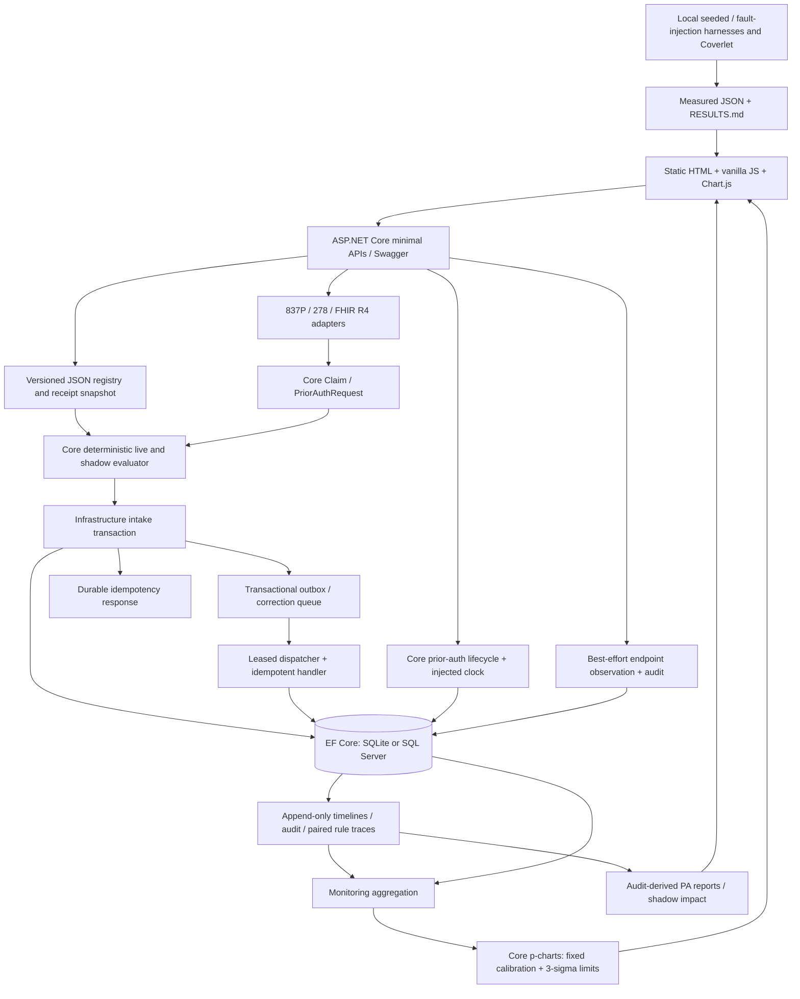

# MediBridge · v0.10.0

Healthcare Claims & Prior Authorization Exception and Recovery Engine. Portfolio
simulation on **synthetic data only**. **Not affiliated with any payer.** Never use
real PHI, real member IDs, or real payer names or branding. Downstream processing is
simulated; no external healthcare services are called.

[Live demo](https://medibridge-abhi.azurewebsites.net/) ·
[Health](https://medibridge-abhi.azurewebsites.net/health) ·
[Measured results](benchmarks/RESULTS.md) · [Benchmark guide](benchmarks/README.md)

The public demo has no authentication. Submit fabricated identifiers only. The
Azure F1 plan has free-tier quotas and may be unavailable or slow to start; a
successful deployment does not guarantee continuous free-tier availability.

## Features

- **Claim intake and validation:** JSON and an ISA-delimited X12 837P subset,
  located segment/element errors, per-interchange 999-style acknowledgments,
  synthetic member guards and 80840-prefix NPI Luhn validation.
- **Exception recovery:** failure classification, five-attempt exponential retry
  with jitter, correction queue for business-rule failures, unique duplicate
  identity, durable idempotency responses and a transactional outbox with leased,
  at-least-once dispatch and idempotent handlers.
- **Prior authorization:** X12 278 and PAS-shaped FHIR R4 Claim intake map into one
  canonical model. Standard/expedited decision clocks, structured denial reasons,
  at-risk/breached escalations and audit-derived turnaround/decision metrics.
- **Versioned rules:** effective-dated DB-backed JSON definitions, immutable hashes
  and promotion history, isolated shadow evaluation, and impact grouped by
  provider, procedure/service code and synthetic plan type.
- **Drift monitoring:** live p-charts per executed rule/version and HTTP endpoint,
  fixed 20-batch calibration, weighted failure rates, variable-sample 3-sigma
  limits and flagged monitoring points. Chart.js controls include an accessible
  table and a separately labeled recorded drift example.
- **Audit and storage:** EF Core migrations for SQLite and SQL Server; append-only
  timelines/evaluations and audited state changes. Provider selection is entirely
  configuration-driven.
- **Measured verification:** real process-kill chaos, HTTP load, X12/FHIR parity,
  accelerated SLA, seeded corpus/shadow replay, drift detection and Core line
  coverage. Raw results and measurement definitions are committed.
- **Demo and CI:** static HTML, vanilla JS, Swagger, xUnit/WebApplicationFactory,
  disposable SQL Server integration tests, Coverlet collection and main deployment.

## Architecture



| Path | Responsibility |
|---|---|
| `src/MediBridge.Api` | Endpoints, DI, workers, endpoint telemetry, Swagger and `wwwroot` |
| `src/MediBridge.Core` | Framework-free deterministic domain, rules, protocol subset parsing, SLA and p-chart math |
| `src/MediBridge.Infrastructure` | EF providers/migrations, adapters, transactional persistence, dispatch and monitoring aggregation |
| `tests/MediBridge.Tests` | Unit, API, persistence, concurrency, migration, recovery and SQL integration tests |
| `benchmarks/` | Reproducible harnesses, coverage reporter, measured JSON artifacts and ledger |
| `samples/`, `docs/`, `infra/` | Fabricated examples, detailed contracts and nonsecret deployment configuration |

Claim intake, timeline, rule evaluation, outbox/queue state and cached HTTP response
commit in the same transaction. Worker transitions append their own audit events.
EF guards and SQLite/SQL Server triggers prevent updates/deletes to append-only
history. These controls protect application integrity; they do not make the database
tamper-proof against administrators. Endpoint observations use a separate audited,
best-effort write and cannot roll back a committed business transaction.

## Run locally

Requires the installed **.NET 10 LTS SDK**. Python 3 is used by result reporters;
k6 is needed only for HTTP load tests. From the repository root:

```sh
dotnet restore
dotnet build
dotnet test
dotnet run --project src/MediBridge.Api --no-launch-profile --urls http://localhost:5080
```

Open [the demo](http://localhost:5080/), [Swagger](http://localhost:5080/swagger), or
[health](http://localhost:5080/health). Health returns
`{"status":"ok","version":"0.10.0"}` and measures process liveness, not dependency
readiness. Startup applies migrations and idempotently seeds four claim scenarios:
missing NPI, downstream timeout/recovery, suppressed duplicate and rule-version
manual review. Existing records and timelines are not overwritten.

SQLite defaults to `src/MediBridge.Api/Data/medibridge.db` locally and
`/home/data/medibridge.db` on Linux App Service. Override with `Database__Path`.
Set `ConnectionStrings__Sql` to select SQL Server/Azure SQL without code changes;
credentials belong in configuration/environment outside source control. Currency
uses invariant decimal text so rejected precision survives across providers.
Known legacy EnsureCreated schemas receive a safe migration baseline (and a SQLite
backup); unknown schemas fail safely. Migrations do not transfer data between providers.

The demo loads Chart.js 4.5.1 from cdnjs with SRI. Its data table remains available
without the CDN. Recorded benchmark views read the exact committed JSON artifacts;
they do not run benchmarks or inject failures into the live app.

## API

| Method | Path | Behavior |
|---|---|---|
| GET | `/health` | Process status and version 0.10.0 |
| GET | `/api/claims`, `/api/claims/{id}` | Claims and click-through audit timelines |
| POST | `/api/claims` | JSON claim validation, classification and asynchronous intake |
| POST | `/api/x12/837` | `text/plain` 837P subset and per-interchange 999-style results |
| POST | `/api/pa/x12-278`, `/api/pa/fhir` | Canonical prior-auth intake from either format |
| GET | `/api/pa/{id}` | Canonical request, validation, lifecycle and timeline |
| POST | `/api/pa/{id}/decisions` | Approved / Denied / Pended; denial requires a defined reason |
| GET | `/api/reports/prior-auth-metrics` | Approval/denial rates and mean/median turnaround by priority |
| GET | `/api/queues/correction`, `/api/outbox` | Non-retryable corrections and delivery status |
| GET / POST | `/api/rules` | List / register immutable rule definitions |
| POST | `/api/rules/{version}/shadow` | Enable/disable candidate evaluation |
| GET | `/api/rules/{version}/shadow-diff` | Recorded live/candidate validation flips and group counts |
| POST | `/api/rules/{version}/promote` | Promote an effective version for new receipts |
| GET | `/api/monitoring/pcharts` | Live rule and endpoint p-charts, denominators and excluded history |
| GET | `/swagger` | Interactive API documentation |

Intake, decision and rule-mutation POSTs require `Idempotency-Key`. Exact replays
return the saved response; changing the body under a used key returns 409. Rule
controls also require `expectedRevision` from `GET /api/rules`. Request bodies are
bounded to 64 KiB. There are no delete/reset API endpoints.

Example synthetic submission (omit `ruleVersion` to resolve the active version):

```sh
curl -i http://localhost:5080/api/claims \
  -H 'Content-Type: application/json' \
  -H 'Idempotency-Key: SYN-JSON-EXAMPLE-1' \
  -d '{"id":"CLM-DEMO-001","providerNpi":"0000000006","memberId":"SYN-DEMO-NEW","serviceDate":"2026-01-20","procedureCodes":["SYN-PROC-02"],"amount":125.50,"planType":"SYN-BASIC","simulation":"None"}'
```

`0000000006` is a fabricated checksum-only NPI; no provider registry is queried.
Use a fresh claim ID and idempotency key for each new experiment. Leave NPI blank
for rejection, use `DownstreamTimeout` for retry/recovery, or explicitly submit an
outdated rule version for manual review. Matching provider/member/date/code-set
identity under a fresh ID demonstrates duplicate suppression.

JSON claim responses contain `claim`, `timeline` and `validation`: 202 for queued
processing or manual review, 200 for duplicate suppression, 422 for persisted
business-rule rejection, and 400 for malformed/bounded transport fields. ID reuse
returns 409. HTTP success does not imply downstream completion or authorization.

## Benchmarks

Every measurement is backed by an executed harness, machine-readable JSON and a
row in [RESULTS.md](benchmarks/RESULTS.md). Results identify their scope and provenance; runtime benchmarks also record their
environment. Historical runs reflect the version tested. No benchmark runs automatically
from the demo. Full commands and limits are in [the benchmark guide](benchmarks/README.md).

| Harness | What it measures | Committed measurements |
|---|---|---|
| [Chaos](benchmarks/chaos/) | Real local host kills/restarts, duplicate effects and recovery; virtual retry clock | [Ledger](benchmarks/RESULTS.md) · [JSON](benchmarks/results/chaos.json) |
| [HTTP load](benchmarks/load/) | POST submission latency and requests/second; processing continues asynchronously | [Ledger](benchmarks/RESULTS.md) · [JSON](benchmarks/results/load.json) |
| [Parity](benchmarks/parity/) | Paired 278/FHIR canonical models and independent expected outcomes | [Ledger](benchmarks/RESULTS.md) · [JSON](benchmarks/results/parity.json) |
| [SLA](benchmarks/sla/) | Accelerated backlog deadlines, escalations and lead time | [Ledger](benchmarks/RESULTS.md) · [JSON](benchmarks/results/sla.json) |
| [Generator](benchmarks/generator/) | Seeded synthetic distributions and local SQLite bulk loading | [Ledger](benchmarks/RESULTS.md) · [JSON](benchmarks/results/generator.json) |
| [Shadow](benchmarks/shadow/) | Local v1/v2 validation flips against independent ground truth | [Ledger](benchmarks/RESULTS.md) · [JSON](benchmarks/results/shadow.json) |
| [Drift](benchmarks/drift/) | Batches until an alert after a known step, plus stationary false alerts | [Ledger](benchmarks/RESULTS.md) · [JSON](benchmarks/results/drift.json) |
| [Core coverage](benchmarks/coverage/) | Coverlet executable lines reached by the test suite | [Ledger](benchmarks/RESULTS.md) · [JSON](benchmarks/results/coverage.json) |

The corpus, shadow, drift, parity, SLA and chaos harnesses run locally. Live load
requires separate approval for a temporary B1 window and confirmed restoration to
F1; it is not part of normal demo or drift execution. Fault injection is configurable
and off by default in production. Core line coverage uses the existing Coverlet
collector and [Core-only settings](coverage.runsettings); see the reporting guide
for exact commands, exclusions and crash-child-process limitations.

## Detailed contracts

- [837P subset, delimiter handling, located errors and acknowledgments](docs/x12-837p-subset.md) · [samples](samples/x12/README.md)
- [Idempotency, retries, outbox, crash recovery and storage cutover](docs/reliable-processing.md)
- [278 / PAS-shaped FHIR intake, canonical mapping and parity](docs/prior-auth-intake.md) · [samples](samples/prior-auth/)
- [Decision clocks, structured decisions, metrics and SLA simulation](docs/prior-auth-decisions.md)
- [Versioned JSON rules, shadow isolation, effective dates and impact](docs/versioned-rules.md)
- [P-chart math, batching, denominator/audit contract and UI](docs/monitoring.md)

## Azure deployment and CI

Nonsecret names and region are recorded in [infra/azure.env](infra/azure.env).
`medibridge-abhi` uses Linux `DOTNETCORE|10.0` on the F1 plan in `westus`; resource
group `rg-medibridge` remains in `eastus`. The configured free-offer Azure SQL
connection is held only in App Service configuration. SQLite remains the default
when that connection is absent. Neither free-tier quota exhaustion nor SQL free-limit
AutoPause is a signal to silently upgrade resources.

[The workflow](.github/workflows/deploy.yml) restores/builds/tests PRs, including a
disposable SQL Server integration test, Core Coverlet collection and reporter tests.
Main also publishes the API and deploys with `azure/webapps-deploy@v3`. The app name
comes from `infra/azure.env`; the publishing profile is held only in GitHub secret
`AZURE_WEBAPP_PUBLISH_PROFILE`. PR revisions use separate concurrency groups; main
deployments remain serialized. SCM basic publishing is enabled for this flow.
Never print publishing profiles or connection strings.

```sh
gh run list --workflow deploy.yml --branch main
gh run watch RUN_ID --exit-status
curl --fail https://medibridge-abhi.azurewebsites.net/health
```

## Roadmap

- **Phase 0 complete:** synthetic claim foundation, validation, timelines, storage and demo.
- **Phase 1 complete:** 837P intake, durable recovery/idempotency/outbox, dual providers and measured chaos/load.
- **Phase 2 complete:** 278/FHIR prior authorization, decision clocks, escalations and measured parity/SLA.
- **Phase 3 complete through chunk 3c:** versioned/shadow rules, seeded corpus/replay, p-chart drift monitoring, measured coverage and benchmark documentation.

Follow [AGENTS.md](AGENTS.md) for new chunks: branch from current main, obtain plan
approval, implement/test, bump the minor version, update docs/UI, and deliver through
PR checks, squash merge and live deployment verification.
