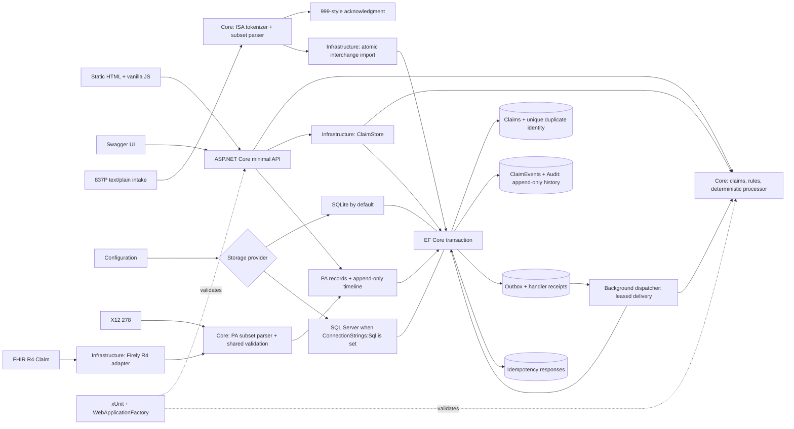

# MediBridge · v0.6.0

Healthcare Claims & Prior Authorization Exception and Recovery Engine. Portfolio simulation on **synthetic data only**. **Not affiliated with any payer.** Never use real PHI, real member IDs, or real payer names or branding. All downstream processing is simulated locally; no healthcare services are called.

Live demo: [MediBridge](https://medibridge-abhi.azurewebsites.net) · [Health](https://medibridge-abhi.azurewebsites.net/health) · [Swagger](https://medibridge-abhi.azurewebsites.net/swagger) · [GitHub](https://github.com/Abhyudaya01/medibridge)

## Chunk 2a: prior authorization intake

Submit the documented X12 278 request subset or a FHIR R4 `Claim` with `use=preauthorization` through the demo's prior-authorization panel. Both map to a common member/provider/service/priority/submitted-time model and an audited intake timeline. **Accepted means intake validation passed; it is not an authorization decision.** FHIR parsing uses `Hl7.Fhir.R4` in Infrastructure; Core stays independent of frameworks.

See [the mapping, supported grammar, PAS-shaped FHIR contract, and API behavior](docs/prior-auth-intake.md), [paired synthetic samples](samples/prior-auth/), and [measured parity results](benchmarks/RESULTS.md). Both POST routes require `Idempotency-Key`. Source submitted timestamps normalize to UTC; receipt timestamps remain in the timeline. The local parity harness compares 200 paired cases against independent expected models and outcomes; invalid inputs are tested as well as accepted ones.

```sh
dotnet run --project benchmarks/parity -c Release
```

## Chunk 1c: measured chaos and HTTP load

[Benchmark harnesses and measurement definitions](benchmarks/README.md) cover real processing-host kills/restarts against isolated SQLite databases and bounded k6 POST load. The chaos default is 1,000 iterations of 50 synthetic claims, 10% invalid, with 20% probabilistic transient failure injection. A harness-only virtual clock advances lease/backoff deadlines; these results measure correctness under crashes, not production recovery latency. [Measured results](benchmarks/RESULTS.md) link to the actual JSON artifacts. Live load requires separate approval for a temporary B1 window and verified restoration to F1; the exact version and SKU tested are recorded. No benchmark runs automatically from the demo page.

## Chunk 1b: reliable processing

Validated submissions are now asynchronous (202/PendingProcessing). Durable outbox delivery, five-attempt exponential retry with jitter, a correction queue for non-retryable business rules, idempotent handlers, and crash recovery are implemented. Both POST endpoints require `Idempotency-Key`; exact matching replays return the original response. GET `/api/queues/correction` and `/api/outbox` expose status; the UI shows queues, attempts, and retries.

See [the reliability, migrations, fault injection, and SQL cutover contract](docs/reliable-processing.md). SQLite remains the configuration default; the deployed app uses the free-offer Azure SQL database recorded in `infra/azure.env`, with AutoPause when monthly free limits are exhausted. The old SQLite file is retained; historical data is not copied automatically between providers. Fault injection is off by default.

## Chunk 1a: X12 837P intake

The Upload X12 panel accepts a synthetic file or pasted interchange and shows parsed claims, exact segment/element errors, and a 999-style result. `POST /api/x12/837` consumes `text/plain` and uses each ISA's declared delimiters. Supported segments are ISA/GS/ST, BHT, provider/subscriber NM1, CLM, HI, SV1, DTP, and SE/GE/IEA. This is a documented portfolio subset and acknowledgment simulation, not a complete production 837P/999 implementation.

See [the exact grammar, mappings, error positions, and acknowledgment contract](docs/x12-837p-subset.md) and [five synthetic samples](samples/x12/README.md).

```sh
curl -i http://localhost:5080/api/x12/837 \
  -H 'Content-Type: text/plain; charset=utf-8' \
  -H 'Idempotency-Key: SYN-X12-EXAMPLE-1' \
  --data-binary @samples/x12/valid.837
```

Each interchange is validated completely before any of its claims is saved. Accepted claims and their audit events commit atomically with the idempotency response; a rejected interchange makes no claim writes. A storage failure rolls back the HTTP request, including all accepted interchanges. A request may contain multiple interchanges with different delimiters and independent results. HTTP 422 means all interchanges were rejected; 200 means at least one was accepted. A duplicate can receive an Accepted syntax acknowledgment while its claim outcome is Suppressed. Existing claim IDs return DuplicateId without changing history. Raw X12 is not stored; HI diagnoses and source controls are retained in X12Intake audit metadata. No schema change is needed.

## Phase 0 behavior

The demo shows a claims summary, transaction monitor, selectable event timeline, and synthetic claim submission form. Rules are deterministic and return `ruleId`, `field`, and `suggestedFix`. They check required fields, positive two-decimal currency, field bounds, and a 10-digit ASCII NPI with a Luhn check using the `80840` prefix. Member IDs must start with `SYN-`. `0000000006` is a fabricated, checksum-only demo NPI; it is not an assigned provider identity. NPI checks do not query a provider registry or establish real-world eligibility.

Duplicate identity consists of the provider NPI, member ID, service date, and normalized procedure-code set. Code order, duplicate code entries, case, and surrounding code whitespace do not change identity; amount and claim ID are excluded. Pending, processing, succeeded, retry-pending, and manual-review claims reserve an identity. Rejected and suppressed claims do not. A unique database index arbitrates matching submissions, with a process-local write gate and recovery from a competing unique-key insert. Reusing an existing claim ID returns 409 and preserves the original timeline.

The idempotent seed inserts only missing claim IDs; restarting never overwrites claims or adds duplicate seed events:

| Claim | Scenario | Final status | Timeline highlights |
|---|---|---|---|
| CLM-1001 | Missing NPI | Rejected | Intake → validation rejection with suggested fix |
| CLM-1002 | Simulated downstream timeout | Succeeded | Validation → timeout → retry pending → retrying → success |
| CLM-1003 | Same identity as CLM-1002 | Suppressed | Validation → duplicate suppression |
| CLM-1004 | Outdated rule version | ManualReview | Validation → rule-version conflict |

`FailureCategory` supports `None`, `Transient`, `BusinessRule`, `Duplicate`, `RuleVersionConflict`, and `Unclassified`. A recovered claim ends with `None`; its transient failure remains in the timeline. Intake events share the supplied UTC timestamp; the dispatcher records actual attempt times and uses durable retry deadlines. The deterministic DownstreamTimeout scenario fails its first real processing attempt, then succeeds on the second.

## Architecture



- `src/MediBridge.Api`: HTTP endpoints, dependency composition, startup seed, Swagger, and `wwwroot` demo UI.
- `src/MediBridge.Core`: domain types, validation, duplicate identity, and deterministic exception/recovery simulation. No framework or third-party dependencies.
- `src/MediBridge.Infrastructure`: EF Core SQLite/SQL Server providers, atomic claim and audit writes, append-only guards, and idempotent seed.
- `tests/MediBridge.Tests`: domain, duplicate, concurrency, audit, seed, and endpoint tests. Each API factory uses an isolated temporary SQLite file.
- `benchmarks/`: local SQLite chaos controller/worker, k6 HTTP load script, measured JSON artifacts, and result ledger.

Claim intake, its outbox/queue state, event timeline, and cached HTTP response commit in one EF transaction. Subsequent worker transitions each append their own audit events. Claim changes without a new audit event, claim deletion, and tracked audit-event modifications/deletions are rejected by the context. SQLite and SQL Server triggers additionally prohibit direct SQL updates/deletes on `ClaimEvents`. These are application integrity controls, not a tamper-proof ledger against database administrators. Use `ClaimsDbContext` for claim writes.

## Run locally

Requires the .NET 10 LTS SDK. From the repository root:

```sh
dotnet restore
dotnet build
dotnet test
dotnet run --project src/MediBridge.Api --no-launch-profile --urls http://localhost:5080
```

Open [the demo](http://localhost:5080/), [Swagger](http://localhost:5080/swagger), or [health](http://localhost:5080/health). Health returns `{"status":"ok","version":"0.6.0"}` and is a process liveness endpoint. Startup initializes storage and seeds the four scenarios before serving requests.

SQLite defaults to `src/MediBridge.Api/Data/medibridge.db` locally and `/home/data/medibridge.db` on Linux App Service. Override its path with `Database__Path` (configuration key `Database:Path`). Parent directories are created automatically. The database is outside the deployed application directory on Azure and persists across zip deployments when App Service storage is enabled.

Set `ConnectionStrings__Sql` (configuration key `ConnectionStrings:Sql`) to use SQL Server/Azure SQL without code changes. Read credentials from environment variables or configuration outside source control. CI tests migrations and processing against a disposable SQL Server instance. Currency is stored as invariant decimal text to preserve rejected precision exactly across providers; the current API does not aggregate amounts in SQL.

Startup now applies provider-specific EF migrations. Known legacy EnsureCreated schemas are baselined without dropping data; unknown schemas fail safely. SQLite receives a legacy backup first. Migration upgrades schemas, not data transfers between providers. There are no delete/reset API endpoints.

## API

| Method | Path | Behavior |
|---|---|---|
| GET | `/health` | 200 with status and version 0.6.0 |
| GET | `/api/claims` | Ordered array of claims and current classification/validation failures |
| GET | `/api/claims/{id}` | Claim, ordered full timeline, and validation failures; 404 if absent |
| POST | `/api/claims` | Validate and atomically persist a claim with its timeline |
| POST | `/api/x12/837` | text/plain subset intake with per-interchange acknowledgment, parsed claims, and import outcomes |
| POST | `/api/pa/x12-278` | Synthetic 278 subset → canonical PA intake + timeline |
| POST | `/api/pa/fhir` | PAS-shaped FHIR R4 Claim → same canonical PA intake + timeline |
| GET | `/api/pa/{id}` | Canonical request, validation outcome and append-only timeline |
| GET | `/api/queues/correction` | Non-retryable business-rule correction items |
| GET | `/api/outbox` | Durable delivery states, counts, and scheduling |
| GET | `/swagger` | Interactive API documentation; schema at `/swagger/v1/swagger.json` |

Example synthetic submission:

```sh
curl -i http://localhost:5080/api/claims \
  -H 'Content-Type: application/json' \
  -H 'Idempotency-Key: SYN-JSON-EXAMPLE-1' \
  -d '{"id":"CLM-DEMO-001","providerNpi":"0000000006","memberId":"SYN-DEMO-NEW","serviceDate":"2026-01-20","procedureCodes":["SYN-PROC-02"],"amount":125.50,"ruleVersion":"phase0-v1","simulation":"None"}'
```

POST returns `{ "claim": ..., "timeline": [...], "validation": [...] }`. Responses are 202 for queued processing or manual review, 200 for a suppressed duplicate, and 422 for a persisted business-rule rejection. A missing/oversized claim ID or oversized transport fields returns 400 before persistence; malformed JSON/dates also return 400. Reusing a claim ID returns 409 with a `DUPLICATE_ID` failure. Status and failure category are computed by the server. Request bodies are bounded to 64 KiB by Kestrel.

Use a new claim ID for each attempt. Leave NPI blank to try rejection; use `"simulation":"DownstreamTimeout"` for deterministic retry/recovery or `"ruleVersion":"phase0-v0"` for manual review. Reuse the four duplicate-identity components with a new ID to see suppression. This is a public synthetic sandbox without authentication; do not send real information.

## Azure deployment and CI

App `medibridge-abhi` uses Linux `DOTNETCORE|10.0` on the F1 (Free) plan `plan-medibridge` in `westus`. Resource group `rg-medibridge` remains in `eastus`; `westus` is the approved subscription-policy fallback. Resource metadata is in `infra/azure.env`, which contains no secrets. Free-tier apps can take time to warm up.

`.github/workflows/deploy.yml` restores, builds, and tests on pull requests. A push to `main` also publishes `src/MediBridge.Api` and deploys through `azure/webapps-deploy@v3`, reading `AZURE_APP_NAME` from `infra/azure.env`. Deployments are serialized. The publishing profile is held only in the repository secret `AZURE_WEBAPP_PUBLISH_PROFILE`; it is never committed or logged. SCM basic publishing is enabled for this flow, and App Service storage is enabled for `/home/data`.

To rotate the secret from an authenticated Azure CLI and GitHub CLI session without printing its contents:

```sh
set -e
profile_path=$(mktemp)
chmod 600 "$profile_path"
trap 'rm -f "$profile_path"' EXIT
az webapp deployment list-publishing-profiles -g rg-medibridge -n medibridge-abhi --xml > "$profile_path"
gh secret set AZURE_WEBAPP_PUBLISH_PROFILE < "$profile_path"
rm -f "$profile_path"
trap - EXIT
```

Watch a deployment with `gh run list --workflow deploy.yml`, then `gh run watch <run-id> --exit-status`. Verify the running version with `curl --fail https://medibridge-abhi.azurewebsites.net/health`.

## Roadmap

- **Phase 0 (implemented):** synthetic claim domain, validation/classification, deterministic recovery scenarios, append-only timelines, EF persistence, demo monitor, tests, and CI deployment.
- **Chunk 1a (implemented):** ISA-delimited 837P subset intake, located errors, 999-style results, atomic imports, five sample files, and Upload X12 demo panel.
- **Chunk 1b (implemented):** durable idempotency, outbox/receipts, bounded retries, correction queue, fault injection, dual-provider migrations, and free-offer Azure SQL.
- **Chunk 1c (implemented):** measured chaos/recovery and HTTP load harnesses; results include test environment and limitations.
- **Phase 1 (next):** richer exception and recovery workflows on the validation/audit/intake foundation.
- **Chunk 2a (implemented):** X12 278 / FHIR R4 prior-authorization intake, canonical mapping, audit timelines, paired samples, and measured parity.
- **Phase 2 (next):** expanded synthetic authorization review, versioned rules, and decision workflows.
- **Phase 3:** expand scale, workload generators, and measured benchmark coverage. Every harness run must produce `benchmarks/results/*.json` and a row in `benchmarks/RESULTS.md`; never hardcode or fabricate results.
